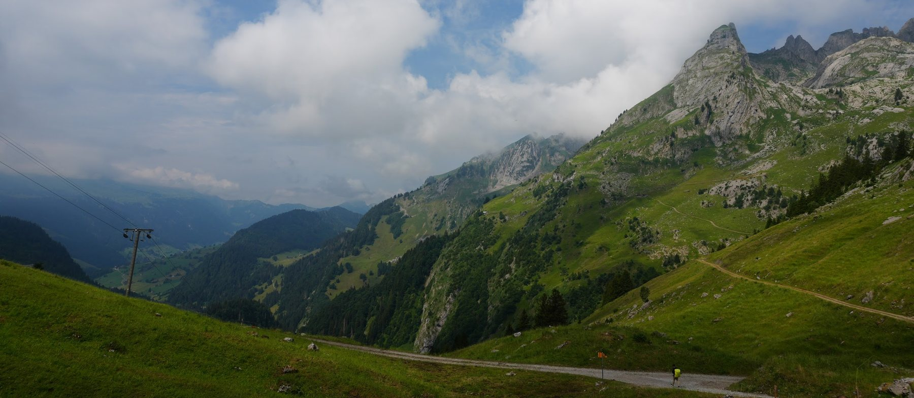

  
   Bergenstauss path, Switzerland · photo by me

<h1 align="center">Hi, I'm Ryan 👋</h1>

  <b>Computer Engineering & Computer Science</b> (joint) at <b>USC</b>, maybe adding Math, Philosophy or Physics. 
  Currently building at <b>Lryn Music</b>. I love building, and I consider myself a polymath. 
  Trying to fundraise for my own off-grid van so I can go homeless.

  
  
  
  

## What I'm into

I love building: electrical hardware, mechanical parts, or software architecture. I want to figure out how it works, make it better, and put it into the world fast.

  
  
  
  
  
  
  
  
  

Outside of code: water polo, swimming, hiking, mountaineering, skiing, surfing, viola, and photography.

## Currently reading

| Book | Author | Progress |
|---|---|---|
| *Aquinas: A Beginner's Guide* | Edward Feser |  |
| *Lord of Mysteries* | Cuttlefish That Loves Diving |  |
| *The Tatami Galaxy* | Tomihiko Morimi |  |
| *Designing Data-Intensive Applications* (2nd ed.) | Martin Kleppmann & Chris Riccomini |  |
| *Mathematics for Machine Learning* | Deisenroth, Faisal & Ong |  |
| *The Art of Problem Solving* (Vol. 1 & 2) | Rusczyk & Lehoczky |  |

## Projects

| | Project | What it is |
|---|---|---|
|  | Startup project | Not revealed yet |
| <picture><source media="(prefers-color-scheme: dark)" srcset="assets/logos/oss-scout-white.svg"></picture> | [OSS Scout](https://github.com/comp-Ryan/oss-scout) | Finds open-source issues worth contributing to, explains them, and drafts the PR only when you click |
|  | [USC KASA](https://usckasa.com) | Ticketing, membership and staff dashboard for USC's Korean American Student Association |
|  | [Drone](https://comp-ryan.github.io/personal_website/projects.html) | My own flight controller PCB (EasyEDA) and frame (Fusion 360) |

## Hackathons

| | Hackathon | Project | What we built |
|---|---|---|---|
|  | Talk to Users Hackathon · Oct 2026 🏆 **Semifinalist** (out of ~80 people) | [Kestrel](https://github.com/hjun-escape/Kestrel) · [live](https://kestrel-app.base44.app/welcome) | Flags public signs of trouble at a bank's borrowers before they show up in quarterly financials (team, Group 17) |
|  | [JacHacks SF](https://jachacks-sf.devpost.com/) · Jul 2026 | [Ember](https://devpost.com/software/ember-ol08u4) | A voice companion with a 3D avatar and reminders, built in Jac |
|  | GDG Stanford × DeepMind · Jul 2026 | [Verifi](https://github.com/comp-Ryan/Verifi) | Live fact-checking for founder pitches with the Gemini Live API |
| <picture><source media="(prefers-color-scheme: dark)" srcset="assets/logos/bankquest-white.png"></picture> | [GKE Turns 10](https://gketurns10.devpost.com/) · Sep 2025 | [BankQuest](https://devpost.com/software/bankquest) | Gemini savings challenges added as a microservice to Google's Bank of Anthos on GKE |

## Tools I use

  
  
  
  
  
  
  
  
  
  
  
  
  
  
  
  
  
  
  

More soon.

